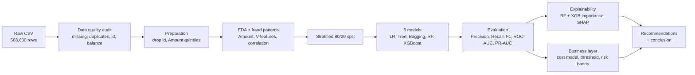

# Credit Card Fraud Risk Analytics — Complete Project Documentation

*What was built, why, how, and what every tool, library and line of code is there for — from first principles to advanced topics, with the whole project told in STAR format.*

> **Reading guide.** Every number below was computed from `creditcard_2023.csv` and can be re-checked in `CreditCardDetection_Project.ipynb`. Where something is an assumption, an illustration, or a limitation, it is labelled as such.
>
> | If you are… | Read |
> |---|---|
> | In a hurry / interviewing tomorrow | [1. At a glance](#1-the-project-at-a-glance) and [2. STAR](#2-the-project-in-star-format) |
> | New to fraud / ML | [3. Level 1 — Basics](#3-level-1--the-basics) |
> | Wanting to know *why each step exists* | [4. Level 2](#4-level-2--understanding-the-data) and [5. Level 3](#5-level-3--machine-learning-models) |
> | Technical reviewer | [6. Level 4 — Advanced](#6-level-4--advanced-topics), [8. Code walkthrough](#8-code-walkthrough-line-by-line-reasoning), [11. Limitations](#11-limitations--honesty-ledger) |
> | Wanting to run it | [9. How to run](#9-how-to-reproduce-it) |

---

## Contents

1. [The project at a glance](#1-the-project-at-a-glance)
2. [The project in STAR format](#2-the-project-in-star-format)
3. [Level 1 — The basics](#3-level-1--the-basics)
4. [Level 2 — Understanding the data](#4-level-2--understanding-the-data)
5. [Level 3 — Machine-learning models](#5-level-3--machine-learning-models)
6. [Level 4 — Advanced topics](#6-level-4--advanced-topics)
7. [Tools, libraries and why each was chosen](#7-tools-libraries-and-why-each-was-chosen)
8. [Code walkthrough (line-by-line reasoning)](#8-code-walkthrough-line-by-line-reasoning)
9. [How to reproduce it](#9-how-to-reproduce-it)
10. [Decision log](#10-decision-log)
11. [Limitations & honesty ledger](#11-limitations--honesty-ledger)
12. [What I would do next](#12-what-i-would-do-next)
13. [Interview questions and answers](#13-interview-questions-and-answers)
14. [Glossary](#14-glossary)
15. [Credits & sources](#15-credits--sources)
16. [Part B: three video approaches and datasets](#16-part-b-three-video-approaches-and-datasets)

---

## 1. The project at a glance

| | |
|---|---|
| **Name** | Credit Card Fraud Risk Analytics & Intelligent Detection System |
| **One-line purpose** | Turn a public fraud dataset into a complete fraud-risk analysis: measure exposure, find what separates fraud from legitimate transactions, build and fairly compare models, explain them, and convert predictions into cost-aware, risk-tiered decisions. |
| **Data** | Kaggle *Credit Card Fraud Detection Dataset 2023* — 568,630 transactions, 31 columns (`id`, `V1`–`V28`, `Amount`, `Class`) |
| **Language / runtime** | Python 3.13, Jupyter Notebook |
| **Models** | Logistic Regression → Decision Tree → Bagging → Random Forest → XGBoost |
| **Selected model** | Random Forest (highest PR-AUC; 0 missed fraud, 19 false alarms on 113,726 test transactions) |
| **Key explanation tool** | SHAP |
| **Business layer** | Configurable cost model, threshold optimisation, risk bands, detection-efficiency table, operational workflow |
| **Deliverables in the repo** | `CreditCardDetection_Project.ipynb` (executed, 54 cells, 17 sections), `README.md`, this document |
| **Not in the repo** | The 325 MB dataset (exceeds GitHub's 100 MB per-file limit — download it from Kaggle and place it beside the notebook) |

### The five findings that matter

1. **The dataset is exactly 50 % fraud / 50 % legitimate** (284,315 each). That is a benchmark construction, not a real fraud rate, so accuracy is *not* misleading here the way it normally is.
2. **`Amount` carries no fraud signal.** Its correlation with `Class` is **0.0023**, it is close to uniformly distributed ($50.01–$24,039.93, skew ≈ 0), and fraud rate is flat (49.8 %–50.2 %) across all five amount quintiles.
3. **All the predictive signal is in the anonymised `V` features.** The strongest are `V14`, `V4`, `V12`, `V10` (consistent across Random Forest, XGBoost and SHAP).
4. **Ensembles are near-perfect; the linear baseline is clearly worse.** Logistic Regression misses 2,718 frauds; Random Forest misses 0.
5. **Those near-perfect scores should not be read as production performance** — the data is unusually clean and separable (see [Limitations](#11-limitations--honesty-ledger)).

### Pipeline in one picture



---

## 2. The project in STAR format

STAR = **S**ituation, **T**ask, **A**ction, **R**esult. It is the standard way to tell a project story in an interview or review. The wording is first-person so it can be spoken; **adapt it to what you personally did** — interviewers probe details, and the rest of this document exists so you can explain every step.

### 2.1 The whole project (about two minutes)

**Situation.** I started from a public notebook on the Kaggle *Credit Card Fraud Detection 2023* dataset (568,630 anonymised transactions). It trained a logistic regression on `V1`–`V5` (6.6 % misclassification), then a Bagging model (0.06 %) and a Random Forest (0.01 %), and claimed `V1`, `V10`, `V14` were the top three features. It was a competent classroom exercise, but it had no business framing, no cost thinking, no explainability, and its claims had never been verified. Its README also described the anonymised `V` features as "time, location, etc.", which the data source does not support.

**Task.** Turn it into something a fraud team could actually reason with: quantify exposure, understand what separates fraud from legitimate activity, compare models using the metrics that matter for fraud, explain the model, translate predictions into cost-aware decisions, and verify — rather than repeat — the inherited claims.

**Action.**
- **Audited the data first.** Zero missing values, zero duplicate rows, `id` unique and non-predictive. Found that the classes are exactly 50/50, that `V1`–`V28` are standardised (mean 0, std 1), and that `Amount` is near-uniform and uncorrelated with fraud — so I dropped the usual "bigger transactions are riskier" story instead of forcing it.
- **Segmented by amount using quintiles** (not invented round-number thresholds) and showed fraud rate is flat across all of them.
- **Built a five-model ladder** on one stratified 80/20 split, each step testing a single hypothesis (is a line enough? is one tree enough? does averaging help? does feature randomisation help? does boosting help?).
- **Judged models on precision, recall, F1, ROC-AUC and PR-AUC**, with PR-AUC as the selection criterion, not accuracy.
- **Explained the model** with Random Forest and XGBoost importances plus SHAP, and used them to *test* the inherited `V1`/`V10`/`V14` claim.
- **Added a business layer:** a configurable cost model, a threshold sweep, four risk bands, and a "how much fraud do I catch for how much review effort" table.
- **Stress-tested my own results:** checked for repeated feature vectors and train/test leakage, and re-ran XGBoost on de-duplicated data.
- **Fixed the documentation:** removed the unsupported "time/location" claim, labelled every assumption, and published the notebook with the dataset excluded because of GitHub's size limit.

**Result.**
- Random Forest: **precision 99.97 %, recall 100.00 %, PR-AUC 0.99998; 0 missed frauds and 19 false alarms out of 113,726 test transactions.** Logistic Regression baseline: 97.72 % precision, 95.22 % recall, 2,718 missed frauds.
- The `V1`/`V10`/`V14` claim was **only partly right**: `V14` and `V10` hold up; `V1` does not make the top five for Random Forest or SHAP.
- `Amount` was shown to be uninformative here — a finding that would have been missed by assuming it matters.
- The leakage check passed: on de-duplicated data XGBoost still reached 99.96 % precision and 100 % recall.
- Honest framing: the results describe a clean benchmark, and the notebook states clearly that real-world performance would be lower.

**Reflection (the "R" that interviewers like).** The most valuable thing was not the 99.98 % accuracy; it was catching that the *dataset* was unrealistic and letting that change what I claimed.

### 2.2 Five shorter STAR stories you can reuse

<details>
<summary><b>A. Correcting an inherited claim</b> (verification mindset)</summary>

- **S:** The existing README said `V1`, `V10`, `V14` were the top three features. That came from simple correlation reasoning, never checked against a trained model.
- **T:** Verify it properly.
- **A:** Ranked features three independent ways — correlation, Random Forest and XGBoost importance, and SHAP — and checked how many methods put each feature in their top five.
- **R:** `V14` is top-5 in all three (RF #2, XGB #1, SHAP #1); `V10` is top-5 in two of three (RF #1, SHAP #4; XGB #7); `V1` only in XGBoost (#5), and ranks 9th by correlation. Verdict: *partially confirmed*, and the documentation was corrected.
</details>

<details>
<summary><b>B. Noticing the data was not realistic</b> (analytical scepticism)</summary>

- **S:** Every model scored above 96 % and the ensembles above 99.9 %.
- **T:** Decide whether that is a result to celebrate or a warning sign.
- **A:** Looked at *why*: exact 50/50 classes, `Amount` uniform with skew ≈ 0, `Amount` independent of `Class`, and near-perfectly polarised predicted probabilities.
- **R:** Concluded the benchmark is likely synthetic/resampled, wrote that caveat into the executive summary, the evaluation section and the conclusion, and told readers to treat the *ranking and methodology* as the takeaway, not the absolute scores.
</details>

<details>
<summary><b>C. Choosing the metric (and the model) deliberately</b></summary>

- **S:** Five models, several metrics, and differences between the top three that appear only in the fourth decimal place.
- **T:** Pick a winner defensibly.
- **A:** Decided the criterion *before* looking: PR-AUC first (it focuses on the fraud class), then recall and false positives. Treated accuracy as a sanity check only.
- **R:** Random Forest won (PR-AUC 0.999981 vs XGBoost 0.999977 vs Bagging 0.999962), but I documented that these top three are practically tied; the real, large gap is between the linear/single-tree models and the ensembles.
</details>

<details>
<summary><b>D. Pressure-testing my own result</b> (leakage check)</summary>

- **S:** Near-perfect scores plus a unique-value count of 552,035 per `V` column (fewer than the 568,630 rows) suggested repeated feature vectors.
- **T:** Rule out train/test leakage as the explanation.
- **A:** Found 16,595 rows repeating a `V` vector (5,149 groups; always the same label, always a different `Amount`); only 3.57 % of test rows had a twin in train; re-split on de-duplicated data (552,035 rows) and re-fit XGBoost.
- **R:** Still 99.96 % precision, 100 % recall, PR-AUC 0.99998 — leakage is not what is driving the scores.
</details>

<details>
<summary><b>E. Turning predictions into a decision</b> (business thinking)</summary>

- **S:** A model that outputs a probability does not tell a fraud team what to do.
- **T:** Connect model output to cost and to review capacity.
- **A:** Built a configurable cost function (missed fraud, false decline, investigation) with clearly labelled illustrative values, swept thresholds 0.10–0.90, built risk bands, and measured fraud captured per share of transactions reviewed.
- **R:** The cost curve shows the minimum at a threshold of 0.55 rather than the default 0.50, and shows cost rising steeply above 0.75 (as missed fraud grows). I stated plainly that because the dataset is so separable the optimum is very flat, and that real costs would move it.
</details>

---

## 3. Level 1 — The basics

*No prior knowledge assumed.*

### 3.1 What is credit-card fraud and why detect it?

Fraud is a transaction made by someone who is not the legitimate cardholder (or otherwise unauthorised). Card networks process enormous volumes, and the costs are lopsided:

| If the system… | Consequence |
|---|---|
| **Misses** a fraud | Direct loss, chargeback, investigation after the fact, an angry customer |
| **Flags** a legitimate purchase | A declined card, a phone call, a frustrated customer, analyst time |

A person cannot review every transaction, so the practical goal is **ranking**: give every transaction a risk score so scarce human attention goes where it matters most.

### 3.2 What is machine learning here?

**Supervised binary classification.** We have historical transactions, each already labelled `Class = 1` (fraud) or `0` (legitimate). A model learns the pattern linking the features (`V1`–`V28`, `Amount`) to the label, then predicts the label — and a probability — for transactions it has not seen.

*Why "supervised"?* Because labels exist. *Why "binary"?* Because there are exactly two outcomes.

### 3.3 The dataset in plain terms

| Column | Meaning | How it was treated |
|---|---|---|
| `id` | Row identifier | Dropped — it identifies a row, it does not describe a transaction |
| `V1`–`V28` | Anonymised numeric features, each standardised to mean 0 / std 1 | Used as predictors. **No real-world meaning is claimed** (see below) |
| `Amount` | Transaction amount ($50.01–$24,039.93) | Used as a predictor and for business segmentation |
| `Class` | 1 = fraud, 0 = legitimate | The target |

> **Why not say what V14 "means"?** Because the data source does not say. Inventing "V14 = location" would be fabrication. The correct statement is *"V14 is one of the strongest predictive anonymised features."*

### 3.4 The confusion matrix — the one table to understand

|  | Model says **fraud** | Model says **legitimate** |
|---|---|---|
| **Actually fraud** | **True positive (TP)** — caught it | **False negative (FN)** — missed it |
| **Actually legitimate** | **False positive (FP)** — false alarm | **True negative (TN)** — correctly cleared |

### 3.5 Precision and recall in simple English

- **Precision** — *"When the alarm rings, how often is it real?"* `TP / (TP + FP)`. Low precision = analysts chase false alarms and customers get declined.
- **Recall** — *"Of all the real fires, how many did the alarm catch?"* `TP / (TP + FN)`. Low recall = fraud slips through.
- **F1** — one number balancing both (their harmonic mean).
- **Accuracy** — share of all predictions that were right. Fine on balanced data (like this one); dangerously misleading when fraud is rare (always saying "legitimate" scores 99.8 %+ while catching nothing).

They usually **trade off**: flag more and recall rises while precision falls.

### 3.6 What does a PR-AUC / AUPRC number mean?

Sweep the flagging threshold from "flag almost nothing" to "flag almost everything" and plot precision against recall. **AUPRC (PR-AUC)** is the area under that curve: 1.0 means perfect precision at every recall level. The crucial point is that a *do-nothing random model* scores roughly the **fraud rate**. On a realistic portfolio with 0.2 % fraud, random ≈ 0.002, so **0.94 would be excellent**. On this 50/50 benchmark random ≈ 0.50, so the bar is higher — and this project's Random Forest scored ≈ **1.00** (0.99998).

---

## 4. Level 2 — Understanding the data

*Each step below states what was done, what was found, and why it matters.*

### 4.1 Data-quality audit (notebook §4)

| Check | Result | Why it matters |
|---|---|---|
| Rows × columns | 568,630 × 31 | Large enough that tree ensembles are stable; also why Bagging takes ~9 minutes |
| Missing values | **0** | No imputation needed (imputation choices can bias results, so none = good) |
| Duplicate full rows | **0** | No obvious double-counting |
| `id` unique | Yes | Pure identifier → excluded to avoid the model memorising row order |
| Class balance | **284,315 / 284,315** | Changes how metrics are read (see §6.1) |
| `V1`–`V28` scale | mean ≈ 0 (max abs 1.5e-16), std = 1.000001 | Already standardised; scaling is irrelevant for trees |
| Target leakage | None found | No column encodes the outcome (no chargeback or investigation fields) |

> **Added after publication — a deeper duplicate check.** Full-row duplicates are 0 *because `id` differs on every row*. Ignoring `id`, **16,595 rows repeat another row's `V1`–`V28` vector** (5,149 groups, 21,744 rows involved). In every such group the label is identical and the `Amount` is different, which fits synthetic generation rather than repeated real transactions. See §6.7 for the leakage test this prompted.

### 4.2 Amount behaves unlike real money (notebook §6–8)

| Statistic | Value |
|---|---|
| Mean / median | $12,041.96 / $12,030.15 |
| Std deviation | $6,919.64 |
| Min / max | $50.01 / $24,039.93 |
| 25th / 75th / 99th percentile | $6,054.89 / $18,036.33 / $23,801.34 |
| Skew | 0.0017 (≈ symmetric) |
| IQR outliers | **0** |
| Correlation with `Class` | **0.0023** |

Real card spend is heavily right-skewed (many small purchases, a few huge ones). A flat, bounded distribution is a strong hint of synthetic data.

**Fraud vs legitimate amounts are indistinguishable:** mean $12,057.60 (fraud) vs $12,026.31 (legitimate); medians $12,062.45 vs $11,996.90.

### 4.3 Amount segmentation — and why it gave a "boring" answer

Buckets use **quintiles** (five equal-count groups) so the thresholds come from the data, not from invented "standard" bands:

| Segment | Range | Transactions | Fraud rate | Share of all fraud value |
|---|---|---:|---:|---:|
| Very Low | $50.01 – $4,854.40 | 113,726 | 49.78 % | 4.07 % |
| Low | – $9,634.71 | 113,727 | 49.86 % | 11.99 % |
| Medium | – $14,429.47 | 113,725 | 50.18 % | 20.04 % |
| High | – $19,235.13 | 113,726 | 50.25 % | 28.07 % |
| Very High | – $24,039.93 | 113,726 | 49.93 % | 35.83 % |

**Reading it correctly:** fraud *rate* is flat (range 0.47 points). Fraud *value* concentrates in high buckets only because those buckets contain bigger transactions — arithmetic, not risk. Conclusion: **amount-based rules ("flag everything over $X") would not work on this population.** The notebook says to repeat the analysis on real, skewed data before drawing any amount-risk conclusion.

### 4.4 Which features separate fraud? (notebook §7, §9)

| Rank | Feature | Correlation with `Class` |
|---:|---|---:|
| 1 | `V14` | −0.806 |
| 2 | `V12` | −0.769 |
| 3 | `V4` | +0.736 |
| 4 | `V11` | +0.724 |
| 5 | `V3` | −0.682 |
| 6 | `V10` | −0.674 |
| 7 | `V9` | −0.586 |
| 8 | `V16` | −0.574 |
| 9 | `V1` | −0.506 |
| 10 | `V2` | +0.492 |

Violin plots of the top features show visibly different distributions for fraud vs legitimate — the opposite of `Amount`.

> **Why correlation is only a first pass:** it measures *linear* association with one feature at a time. It can miss features that matter through interactions — which is exactly why `V1` looked more important by correlation than by tree models.

---

## 5. Level 3 — Machine-learning models

### 5.1 The experimental design (and why)

| Choice | What | Why |
|---|---|---|
| Split | 80 % train (454,904) / 20 % test (113,726) | Standard hold-out; the test set is never used for fitting |
| **Stratified** | Class proportions preserved in both sets (50/50 each) | Good practice regardless of balance — essential once data is imbalanced |
| `random_state=42` | Fixed seed | Reproducibility: same split every run |
| Features | `V1`–`V28` + `Amount` (29) | `id` excluded |
| Scaling | `StandardScaler`, **fit on train only**, applied to Logistic Regression only | Linear models are scale-sensitive; trees are not. Fitting on train only prevents test information leaking into preprocessing |
| One shared test set | All five models are scored on the identical 113,726 rows | A fair comparison |

### 5.2 The model ladder — each rung tests one idea

| # | Model | Idea it tests | Settings (and why) |
|---|---|---|---|
| 1 | **Logistic Regression** | *Is a straight-line boundary enough?* Simplest, most explainable baseline | `max_iter=1000` (ensure convergence), on scaled features |
| 2 | **Decision Tree** | *Is the relationship nonlinear?* One tree can bend | `max_depth=10` — deliberately limited so it stays a simple, interpretable step rather than memorising |
| 3 | **Bagging** | *Does averaging many trees (variance reduction) help?* Each tree sees a bootstrap resample | `n_estimators=50` (balance of quality and the ~9 min runtime), `n_jobs=-1` |
| 4 | **Random Forest** | *Does also randomising features per split help?* Decorrelates the trees further | `n_estimators=100`, `n_jobs=-1` |
| 5 | **XGBoost** | *Does a different ensemble strategy help?* Boosting: trees fix each other's errors sequentially | `n_estimators=200`, `max_depth=6`, `eval_metric="logloss"` |

> **Honesty note:** these hyper-parameters are sensible defaults chosen for the runtime/quality balance — **no cross-validated hyper-parameter search was run**. The original notebook contained commented-out `GridSearchCV` code; it was not executed.

### 5.3 How each family works (intuition)

- **Logistic regression** adds up weighted features into a score and squashes it to 0–1. One weight per feature → easy to read, but the boundary is a flat plane.
- **Decision tree** asks a sequence of yes/no questions ("is `V14` < −0.4?") and ends in a leaf with a prediction. Can model bends and interactions; a single unconstrained tree tends to overfit.
- **Bagging** trains many trees on random resamples and averages them — the noise of any one tree cancels out.
- **Random Forest** is bagging plus: at each split only a random subset of features is considered. Trees become less alike, so averaging is more effective. This is why it usually beats plain bagging.
- **XGBoost** builds trees one after another, each trained on the *mistakes* of the ensemble so far. Powerful, usually the industry default for tabular data.

### 5.4 Results on the held-out test set

| Model | Accuracy | Precision | Recall | F1 | ROC-AUC | PR-AUC | False positives | False negatives |
|---|---:|---:|---:|---:|---:|---:|---:|---:|
| Logistic Regression | 96.50 % | 97.72 % | 95.22 % | 96.45 % | 0.9935 | 0.9944 | 1,265 | 2,718 |
| Decision Tree | 98.62 % | 98.57 % | 98.68 % | 98.63 % | 0.9965 | 0.9960 | 812 | 752 |
| Bagging | 99.95 % | 99.91 % | 99.99 % | 99.95 % | 0.99998 | 0.99996 | 50 | 7 |
| **Random Forest** | **99.98 %** | **99.97 %** | **100.00 %** | **99.98 %** | **0.99999** | **0.99998** | **19** | **0** |
| XGBoost | 99.98 % | 99.95 % | 100.00 % | 99.98 % | 0.99998 | 0.99998 | 28 | 0 |

Confusion-matrix counts (TN / FP / FN / TP): LR 55,598 / 1,265 / 2,718 / 54,145 · Tree 56,051 / 812 / 752 / 56,111 · Bagging 56,813 / 50 / 7 / 56,856 · **RF 56,844 / 19 / 0 / 56,863** · XGB 56,835 / 28 / 0 / 56,863.

### 5.5 Why Random Forest over Logistic Regression

1. **It missed nothing** (0 vs 2,718 false negatives) and raised precision (99.97 % vs 97.72 %): fewer missed frauds *and* far fewer false alarms (19 vs 1,265).
2. The performance jump from linear (96.5 %) to a single tree (98.6 %) to ensembles (>99.9 %) shows the fraud region is **nonlinear** — a straight boundary cannot carve it out.
3. **The cost of the switch is interpretability**, which SHAP (§6.3) is used to restore.
4. **Caveat:** Random Forest, XGBoost and Bagging are practically tied (PR-AUC differences appear in the 5th decimal). Random Forest is chosen by the pre-declared rule (highest PR-AUC) and because it is the original project's model, not because it is meaningfully better than XGBoost.

---

## 6. Level 4 — Advanced topics

### 6.1 Class imbalance — handled by recognising there is none

The data is 50/50, so SMOTE, undersampling and class weights were **not** applied — that would solve a problem the data does not have. What *is* kept because it is good practice and costs nothing: stratified splitting, and evaluation on precision/recall/PR-AUC rather than accuracy. If the pipeline is ever pointed at real, imbalanced data, the lever to reach for first is **class weights** (`class_weight="balanced"` / XGBoost `scale_pos_weight`), then threshold tuning.

### 6.2 Why PR-AUC and not just ROC-AUC or accuracy

- **Accuracy** hides the cost asymmetry and fails badly under imbalance.
- **ROC-AUC** includes true negatives, which dominate in imbalanced data and flatter the score.
- **PR-AUC** looks only at the positive (fraud) class: *how clean are the alerts as I try to catch more?* It is the more honest metric for fraud, so it is the selection criterion.

### 6.3 Explainability: global importance and SHAP

Three views of "what does the model rely on?":

| Rank | Random Forest | XGBoost | SHAP (mean \|impact\|) |
|---:|---|---|---|
| 1 | `V10` | `V14` | `V14` |
| 2 | `V14` | `V4` | `V4` |
| 3 | `V4` | `V12` | `V12` |
| 4 | `V12` | `V8` | `V10` |
| 5 | `V11` | `V1` | `V17` |
| 6 | `V17` | `V3` | `V11` |
| 7 | `V16` | `V10` | `V3` |
| 8 | `V7` | `V17` | `V16` |
| 9 | `V3` | `V2` | `V7` |
| 10 | `V2` | `V11` | `V8` |

**What SHAP is:** for each prediction it splits the output among the features (based on Shapley values from game theory) so you can say *"this transaction scored high mainly because of `V14` and `V4`."* `TreeExplainer` is exact and fast for tree models.

**Testing the inherited "V1, V10, V14" claim:**

| Feature | In RF top-5 | In XGB top-5 | In SHAP top-5 | Verdict |
|---|:---:|:---:|:---:|---|
| `V14` | yes (#2) | yes (#1) | yes (#1) | Strongly confirmed |
| `V10` | yes (#1) | no (#7) | yes (#4) | Confirmed in 2 of 3 |
| `V1` | no | yes (#5) | no (not top-10) | **Weak** — claim only partly supported |

**Prediction ≠ causation.** Importance and SHAP describe what the model *uses*, not what *causes* fraud.

### 6.4 Cost-sensitive decision-making

The dataset has no money-loss fields, so costs are **illustrative assumptions** (labelled as such in the notebook) designed to be replaced with real figures:

| Assumption | Illustrative value |
|---|---:|
| Cost of one missed fraud | $500 |
| Cost of one false decline | $15 |
| Cost of manually reviewing one flagged transaction | $5 |

`Total cost = FN × 500 + FP × 15 + TP × 5`. Threshold sweep for Random Forest:

| Threshold | FP | FN | Precision | Recall | Total cost |
|---:|---:|---:|---:|---:|---:|
| 0.10 | 313 | 0 | 99.5 % | 100 % | $289,010 |
| 0.30 | 32 | 0 | 99.9 % | 100 % | $284,795 |
| 0.50 (default) | 19 | 0 | ~100 % | 100 % | $284,600 |
| **0.55 (minimum)** | **14** | **0** | ~100 % | 100 % | **$284,525** |
| 0.60 | 11 | 1 | ~100 % | ~100 % | $284,975 |
| 0.75 | 6 | 7 | ~100 % | 99.99 % | $287,870 |
| 0.90 | 3 | 209 | 100 % | 99.6 % | $387,815 |

**How to read it:** lowering the threshold adds false alarms; raising it lets fraud through, and because a miss is assumed to cost 33× a false alarm, cost explodes on the right. **Be careful with the absolute numbers:** about $284,315 of every total is simply the review cost of the 56,863 true frauds, which no threshold can avoid — the *decision-relevant* part is the small difference between rows. And the optimum (0.55) beats the default (0.50) by only $75, because this data is so cleanly separable.

### 6.5 Risk bands and review capacity

Illustrative bands on predicted probability (edges are configurable, **not** validated production thresholds):

| Band | Probability | Transactions | Fraud | Fraud rate |
|---|---|---:|---:|---:|
| Low | 0.00–0.25 | 56,816 | 0 | 0.00 % |
| Medium | 0.25–0.50 | 28 | 0 | 0.00 % |
| High | 0.50–0.75 | 20 | 7 | 35.00 % |
| Critical | 0.75–1.00 | 56,862 | 56,856 | 99.99 % |

Note the empty middle: predictions are **bimodal** (almost everything is near 0 or 1) because the classes separate so cleanly. On real, noisier data the middle bands would hold far more transactions, and that is where "extra verification" tiers earn their keep.

**Detection efficiency** — rank every test transaction by risk and review the top slice:

| Review top… | Transactions reviewed | Frauds found | Precision of slice | Share of all fraud captured |
|---:|---:|---:|---:|---:|
| 1 % | 1,137 | 1,137 | 100 % | 2 % |
| 5 % | 5,686 | 5,686 | 100 % | 10 % |
| 10 % | 11,372 | 11,372 | 100 % | 20 % |
| 20 % | 22,745 | 22,745 | 100 % | 40 % |

Because fraud is 50 % of the data, the best possible capture at X % review is 2X %; the model achieves that ceiling — every flagged item in those slices is real. On a realistic 0.2 %-fraud stream this table would look very different, and it is the single most useful table for sizing an investigation team.

### 6.6 Operational workflow

```
Transaction → Data validation → Fraud-risk model → Risk score (0–1)
    ├─ Low      → Approve
    ├─ Medium   → Extra verification (e.g. step-up authentication)
    ├─ High     → Manual-review queue
    └─ Critical → Block / escalate to fraud team
```

The action at each band is **institution policy**, calibrated with the cost framework — the notebook provides the score and the calibration tooling, not a fixed policy.

### 6.7 Robustness check: is it leakage?

Concern: repeated `V` vectors could put the same row in both train and test, inflating scores. Test:

```python
vcols = [c for c in df.columns if c.startswith("V")]
dedup = df.drop_duplicates(subset=vcols)          # 568,630 -> 552,035 rows
# re-split (stratified, seed 42) and re-fit XGBoost on the de-duplicated data
```

| Measure | Result |
|---|---|
| Rows repeating a `V` vector | 16,595 (5,149 groups) |
| Groups with conflicting labels | 0 |
| Test rows with an exact twin in train (original split) | 4,056 (3.57 %) |
| XGBoost on de-duplicated data | precision 99.96 %, recall 100.00 %, PR-AUC 0.99998, FP 21, FN 0 |

**Conclusion:** the near-perfect scores are **not** a leakage artefact. They reflect how separable this dataset is.

### 6.8 Other advanced concepts (where they appear, or why they do not)

| Concept | Status in this project |
|---|---|
| Probability calibration (Platt / isotonic) | Not done — recommended before using raw probabilities for risk bands in production (tree ensembles are often mis-calibrated) |
| Cross-validation | Not done — single stratified split; a k-fold run would quantify variance |
| Hyper-parameter tuning | Not done — defaults chosen for runtime; see §12 |
| Time-aware validation / drift monitoring | Not possible — **no usable timestamp** exists; temporal analysis was explicitly *not* fabricated |
| Resampling (SMOTE) | Deliberately not used — data is already balanced |

---

## 7. Tools, libraries and why each was chosen

### 7.1 Environment (as run)

Python 3.13.9 · pandas 2.3.3 · numpy 2.3.5 · matplotlib 3.10.6 · seaborn 0.13.2 · scikit-learn 1.7.2 · xgboost 3.3.0 · shap 0.52.0 · Jupyter / nbconvert.

### 7.2 What each tool does here, and the alternatives

| Tool | Used for | Why this one | Alternatives |
|---|---|---|---|
| **Python** | Everything | The de-facto language for data science; huge ecosystem | R, Julia |
| **Jupyter Notebook** | Narrative + code + charts in one file | Readers see code, output and explanation together; ideal for analysis and portfolios | Scripts + a report, Quarto, Databricks notebooks |
| **pandas** | Load CSV, filter, group, aggregate, quantile-bucket | Standard tabular toolkit; `qcut`, `groupby`, `agg` express the analysis in a few lines | Polars (faster), SQL (see §7.3) |
| **NumPy** | Arrays, thresholds, sorting probabilities | Foundation of the stack; vectorised maths | — |
| **matplotlib** | Charts and custom plots (threshold curve, ROC/PR) | Full control over figures | Plotly (interactive) |
| **seaborn** | Statistical plots (heatmap, violin, box, KDE, count) | Concise, good-looking defaults on top of matplotlib | Plotly Express, Altair |
| **scikit-learn** | Split, scaling, Logistic Regression, Decision Tree, Bagging, Random Forest, all metrics | One consistent `fit`/`predict` API across models; reliable metric implementations | statsmodels (statistical inference), PyTorch/TensorFlow (overkill for tabular) |
| **XGBoost** | Gradient-boosted trees | Industry-standard tabular model; a genuinely different algorithm to compare against forests | LightGBM, CatBoost (LightGBM was not installed here) |
| **SHAP** | Explain model predictions | Theoretically grounded, consistent, and fast for tree models via `TreeExplainer` | LIME, permutation importance, partial-dependence plots |
| **nbconvert** | Execute the notebook top-to-bottom | Guarantees the stored outputs come from a real, clean run | Run manually in Jupyter |
| **Git / GitHub** | Version control and publishing | Standard portfolio and collaboration platform | GitLab, Bitbucket |

### 7.3 What was **not** used, and why

- **SQL** — not used. All loading, cleaning and aggregation is pandas on a single CSV. SQL would be the right tool if the data lived in a warehouse; a natural extension is to load the CSV into SQLite/Postgres and re-express the §4 aggregations as queries (see §12).
- **statsmodels / SciPy** — used in the *original* notebook for GLM z-scores; the rebuilt notebook uses SHAP and model-based importance instead, which handle nonlinear models.
- **imbalanced-learn (SMOTE)** — unnecessary on balanced data.
- **Deep learning** — adds cost and opacity with no expected gain on 29 tabular features where trees already reach ~100 %.

---

## 8. Code walkthrough (line-by-line reasoning)

The notebook is organised in 17 numbered sections. This maps them, then explains the code that matters.

### 8.1 Notebook map

| § | Section | Purpose |
|---|---|---|
| 1 | Executive Summary | KPI table and answers in business language |
| 2 | Business Problem | The questions being answered |
| 3 | Dataset Understanding | Imports, load, `info`, `describe` |
| 4 | Data Quality Assessment | Missing, duplicates, uniqueness, balance, leakage, correlation heatmap |
| 5 | Cleaning & Preparation | Feature/target matrices, amount quintiles |
| 6 | Exploratory Data Analysis | Amount distribution, box plot, density by class |
| 7 | Fraud Pattern Analysis | Fraud vs legitimate: counts, amounts, violin plots of top features |
| 8 | Transaction Amount Analysis | Quintile segment table and charts |
| 9 | Feature Analysis | Correlation ranking, test of the V1/V10/V14 claim (preliminary) |
| 10 | Class Imbalance | Why this dataset is not imbalanced and what that means |
| 11 | Machine Learning | Split, scaling, five models |
| 12 | Model Evaluation | Comparison table, confusion matrices, ROC/PR curves |
| 13 | Explainability | RF/XGB importance, SHAP, final verdict on V1/V10/V14 |
| 14 | Business Risk Analysis | Cost model, threshold sweep, risk bands |
| 15 | Operational Fraud Workflow | Workflow diagram, detection efficiency |
| 16 | Business Recommendations | Ten recommendations, each tied to a finding |
| 17 | Final Conclusion | What / why / discovered / predicts / best / do / next |

### 8.2 Imports — each one has a job

```python
import numpy as np
import pandas as pd
import matplotlib.pyplot as plt
import matplotlib.ticker as mticker
import seaborn as sns

from sklearn.model_selection import train_test_split
from sklearn.preprocessing import StandardScaler
from sklearn.linear_model import LogisticRegression
from sklearn.tree import DecisionTreeClassifier
from sklearn.ensemble import BaggingClassifier, RandomForestClassifier
from xgboost import XGBClassifier
from sklearn.metrics import (accuracy_score, precision_score, recall_score, f1_score,
                              roc_auc_score, average_precision_score, confusion_matrix,
                              roc_curve, precision_recall_curve, ConfusionMatrixDisplay)
import shap

sns.set_theme(style="whitegrid", palette="deep")
RANDOM_STATE = 42
```

- `train_test_split` → hold out a test set; `StandardScaler` → scale for the linear model.
- Four sklearn models + `XGBClassifier` → the model ladder (§5.2).
- `average_precision_score` is the standard sklearn estimate of **PR-AUC**; `roc_auc_score` gives ROC-AUC; `confusion_matrix` gives TP/FP/FN/TN.
- `RANDOM_STATE = 42` is one constant reused everywhere so every random step is reproducible.
- `mticker` is only for formatting axis labels as `$x.xM`.

### 8.3 Loading and auditing

```python
df = pd.read_csv("creditcard_2023.csv")

quality_report = pd.DataFrame({
    "dtype": df.dtypes,
    "missing_values": df.isna().sum(),
    "missing_pct": (df.isna().sum() / len(df) * 100).round(4),
    "n_unique": df.nunique(),
})
```

Builds one table of dtype, missing count/percent and unique count per column. `n_unique` is what exposed that `id` is unique per row (so non-predictive) — and, later, that each `V` column has fewer unique values (552,035) than rows (568,630), which prompted the repeated-vector check in §6.7.

```python
print("Duplicate rows:", df.duplicated().sum())
print("id column is unique identifier:", df['id'].nunique() == len(df))
```

> `df.duplicated()` compares **all** columns including `id`, so it can only ever return 0 here. The stronger test is `df.duplicated(subset=vcols)` (§6.7).

### 8.4 Preparation and the amount quintiles

```python
feature_cols = v_cols + ["Amount"]
X = df[feature_cols].copy()
y = df["Class"].copy()

bucket_labels = ["Very Low", "Low", "Medium", "High", "Very High"]
df["AmountBucket"] = pd.qcut(df["Amount"], q=5, labels=bucket_labels)
```

`id` is excluded from `X` simply by not listing it. `pd.qcut(q=5)` cuts at the 20/40/60/80th percentiles so each segment holds ~20 % of transactions and the edges come **from the data** — the reason is the project rule *"do not claim arbitrary thresholds are business-standard."*

### 8.5 Evaluation helper — one function, five models, identical treatment

```python
def evaluate_model(name, model, X_tr, X_te):
    model.fit(X_tr, y_train)
    y_pred = model.predict(X_te)
    y_proba = model.predict_proba(X_te)[:, 1] if hasattr(model, "predict_proba") else y_pred
    tn, fp, fn, tp = confusion_matrix(y_test, y_pred).ravel()
    return model, {
        "Accuracy": accuracy_score(y_test, y_pred),
        "Precision": precision_score(y_test, y_pred),
        "Recall": recall_score(y_test, y_pred),
        "F1": f1_score(y_test, y_pred),
        "ROC-AUC": roc_auc_score(y_test, y_proba),
        "PR-AUC": average_precision_score(y_test, y_proba),
        "FP": fp, "FN": fn, "TP": tp, "TN": tn,
        "y_proba": y_proba,
    }
```

- **Why a function?** So every model is scored by the same code on the same test set — a fair comparison.
- `predict` gives hard 0/1 labels (threshold 0.5), used for precision/recall/confusion matrix.
- `predict_proba(...)[:, 1]` gives the probability of class 1, required for **ROC-AUC, PR-AUC, ROC/PR curves, threshold sweeps and risk bands** — AUC metrics must use scores, not hard labels.
- `.ravel()` flattens the 2×2 confusion matrix into `tn, fp, fn, tp`.
- The probabilities are stored (`y_proba`) so later sections reuse them without retraining.

### 8.6 Training

```python
trained_models["Logistic Regression"], results["Logistic Regression"] = evaluate_model(
    "Logistic Regression", LogisticRegression(max_iter=1000, random_state=RANDOM_STATE),
    X_train_scaled, X_test_scaled)

trained_models["Random Forest"], results["Random Forest"] = evaluate_model(
    "Random Forest", RandomForestClassifier(n_estimators=100, random_state=RANDOM_STATE, n_jobs=-1),
    X_train, X_test)
```

- Logistic Regression receives the **scaled** arrays; the tree models receive the raw ones (trees split on thresholds, so monotonic scaling changes nothing).
- `n_jobs=-1` uses every CPU core — it is why training finishes in minutes, not hours.
- `max_iter=1000` prevents a convergence warning from the default 100.

Measured fit times on the author's machine (standalone run): Logistic Regression ~1.4 s, XGBoost ~7.8 s, Decision Tree ~24 s, Random Forest ~173 s, Bagging ~555 s.

### 8.7 ROC and precision-recall curves

```python
for name, r in results.items():
    fpr, tpr, _ = roc_curve(y_test, r["y_proba"])
    axes[0].plot(fpr, tpr, label=f"{name} (AUC={r['ROC-AUC']:.3f})")
...
    prec, rec, _ = precision_recall_curve(y_test, r["y_proba"])
    axes[1].plot(rec, prec, label=f"{name} (AP={r['PR-AUC']:.3f})")
```

Overlaying all models on one pair of axes makes the comparison visual: the linear and single-tree curves bend away from the corner, the three ensembles hug it.

### 8.8 SHAP

```python
explainer = shap.TreeExplainer(best_model_obj)
rng = np.random.RandomState(RANDOM_STATE)
sample_idx = rng.choice(len(X_test), size=min(2000, len(X_test)), replace=False)
X_sample = X_test.iloc[sample_idx]
shap_values = explainer.shap_values(X_sample)
if isinstance(shap_values, list):  shap_values = shap_values[1]       # older SHAP: list per class
if shap_values.ndim == 3:          shap_values = shap_values[:, :, 1]  # newer SHAP: (rows, features, classes)
shap.summary_plot(shap_values, X_sample, plot_type="bar", show=False)
```

- `TreeExplainer` is exact and fast **for tree models** (a model-agnostic explainer would be far slower).
- A **2,000-row random sample** (fixed seed) keeps runtime manageable; global rankings stabilise quickly.
- The two `if` lines normalise SHAP's output shape across library versions so the notebook does not break on upgrade.
- The bar plot shows mean absolute impact (global ranking); the default summary plot adds the *direction* of each feature's effect.

### 8.9 Cost model and threshold sweep

```python
for th in np.arange(0.1, 0.95, 0.05):
    y_pred_th = (best_proba >= th).astype(int)
    tn, fp, fn, tp = confusion_matrix(y_test, y_pred_th).ravel()
    total_cost = fn * COST_FN + fp * COST_FP + tp * COST_INVESTIGATION
```

Re-labels every transaction at each candidate threshold, recounts the errors, and prices them. The `COST_*` constants sit at the top of the cell so a user can edit three numbers and re-run — a *scenario tool*, not a verdict.

### 8.10 Risk bands and detection efficiency

```python
risk_bands_cut = pd.cut(best_proba, bins=[-0.01, 0.25, 0.5, 0.75, 1.0],
                        labels=["Low", "Medium", "High", "Critical"])

for frac in [0.01, 0.05, 0.10, 0.20]:
    n_flag = int(len(best_proba) * frac)
    top_idx = np.argsort(best_proba)[::-1][:n_flag]       # highest-risk first
    fraud_captured = y_test.values[top_idx].sum()
```

`pd.cut` uses the fixed edges (the `-0.01` lower bound ensures a probability of exactly 0 is included). `np.argsort(...)[::-1]` ranks transactions from highest to lowest risk, and the loop answers "if analysts can only review X %, how much fraud do we get?"

---

## 9. How to reproduce it

### 9.1 Setup

```bash
git clone https://github.com/SNEHAJUYAL/Credit-card-fraud-detection.git
cd Credit-card-fraud-detection
pip install pandas numpy matplotlib seaborn scikit-learn xgboost shap jupyter
```

Download **`creditcard_2023.csv`** from the Kaggle dataset page (link in §15) and place it in the repo folder **beside the notebook** (it is git-ignored, so it never gets committed).

### 9.2 Run

Interactive:

```bash
jupyter notebook CreditCardDetection_Project.ipynb
```

Or headless, regenerating every output:

```bash
jupyter nbconvert --to notebook --execute --inplace CreditCardDetection_Project.ipynb \
  --ExecutePreprocessor.timeout=1800
```

**Expect roughly 15–20 minutes**, dominated by Bagging (~9 min) and Random Forest (~3 min). To iterate faster, lower `n_estimators` in the Bagging/Random Forest cells — results change slightly.

### 9.3 Repository contents

| File | Purpose | In Git? |
|---|---|---|
| `CreditCardDetection_Project.ipynb` | The analysis (executed, with outputs) | Yes |
| `README.md` | Short overview | Yes |
| `PROJECT_DOCUMENTATION.md` | This document | Yes |
| `.gitignore` | Keeps large data and cruft out | Yes |
| `creditcard_2023.csv` | 325 MB dataset | **No** — over GitHub's 100 MB limit |

---

## 10. Decision log

| # | Decision | Reason | Alternative considered |
|---|---|---|---|
| 1 | Verify claims, don't copy them | The prompt and good practice require traceability | Repeat the README's figures |
| 2 | Treat `V1`–`V28` as anonymised statistical features | The source gives no meanings; inventing them would be fabrication | Label them "time/location" as the old README did |
| 3 | Quintile amount buckets | Thresholds derived from data, not invented | Round-number bands ($100, $1,000…) |
| 4 | No temporal analysis | There is no usable timestamp; `id` is a row index | Treat `id` as time (unjustified) |
| 5 | No resampling | Data is already 50/50 | SMOTE / undersampling |
| 6 | Stratified split, fixed seed | Preserves class mix; reproducible | Random split, or k-fold CV |
| 7 | Scale only for Logistic Regression, fit on train only | Trees are scale-invariant; avoids leakage | Scale everything |
| 8 | Select by PR-AUC | Focuses on the fraud class; decided before seeing results | Accuracy, F1, ROC-AUC |
| 9 | Five models, each with a stated purpose | Avoid padding the comparison | Many more models |
| 10 | Illustrative costs, clearly labelled | No cost data exists; framework matters more than the numbers | Invent "industry" costs |
| 11 | Bands are configurable defaults, not policy | Real thresholds need calibration on real outcomes | Present 25/50/75 as standard |
| 12 | Exclude dataset from Git | GitHub rejects files over 100 MB | Git LFS (needs quota/setup) |
| 13 | Execute the notebook and inspect the charts | Stored outputs must be real | Describe expected output |

---

## 11. Limitations & honesty ledger

1. **Synthetic-looking data.** Exact 50/50 balance, near-uniform `Amount` independent of `Class`, repeated `V` vectors with different amounts, and near-perfect separability all suggest the dataset is generated or resampled. The Kaggle page does not document how. Treat results as a *methodology demonstration*, not a forecast.
2. **Scores are saturated.** The three ensembles sit within 0.0004 of each other on accuracy; model "ranking" among them is weak evidence. The meaningful gap is linear/single-tree vs ensembles.
3. **No hyper-parameter tuning, no cross-validation.** One split, sensible defaults.
4. **Cost numbers are illustrative.** The conclusions about the best threshold depend on them and would change with real costs.
5. **Risk bands are illustrative.** The middle bands are almost empty because predictions are bimodal — the band *method* transfers to real data, the band *populations* do not.
6. **Probabilities are uncalibrated.** Tree ensembles are directionally right but not guaranteed to be calibrated.
7. **No time dimension.** No drift, seasonality, or time-ordered validation is possible.
8. **Importance ≠ causation.** SHAP explains the model, not the world.
9. **Duplicate check wording.** §4 of the notebook reports 0 duplicate rows, which is true only because it includes `id`. The repeated-`V`-vector finding (§4.1 / §6.7 here) was added afterwards and is not yet in the notebook itself.
10. **"PCA-style" wording.** The notebook describes `V` features as PCA-like; the data shows they are *standardised* (std 1.000001). Whether they come from PCA is not documented by the source.

---

## 12. What I would do next

**Quick wins (hours)**
- Add the repeated-vector / leakage check as a notebook cell and correct the "PCA-style" wording.
- Add `requirements.txt` pinning the tested versions.
- Add 5-fold stratified cross-validation to report mean ± std for each model.

**Intermediate (days)**
- Hyper-parameter search (`RandomizedSearchCV` on PR-AUC) for RF and XGBoost.
- Probability calibration (`CalibratedClassifierCV`) and a reliability diagram before re-cutting risk bands.
- A **SQL layer**: load the CSV into SQLite/Postgres and reproduce the amount-segment and class aggregations with `NTILE`, `GROUP BY`, `CASE`, then compare with pandas.
- Interactive dashboard (e.g. Streamlit) with the cost sliders live.

**Advanced (weeks)**
- Re-run the whole pipeline on a **real, imbalanced, timestamped** dataset: class weights, time-based train/validation/test, PR-AUC at fixed review budgets.
- Cost-sensitive learning (weights, custom objective) instead of post-hoc thresholding.
- Model governance: versioned models, logged thresholds, drift monitors (population-stability index on `V` features), scheduled retraining, champion/challenger tests.
- Investigator tooling: per-transaction SHAP reason codes surfaced in a review UI.

---

## 13. Interview questions and answers

**Why fraud detection?** Because errors are asymmetric — a missed fraud costs far more than a check — and humans cannot review every transaction, so a ranking model focuses limited attention.

**Why those models?** A ladder, each rung testing one idea: line → single tree → averaged trees → feature-randomised trees → boosted trees. No model added just for count.

**Why Random Forest over Logistic Regression?** It caught every fraud (0 vs 2,718 missed) with far fewer false alarms (19 vs 1,265), because the fraud region is nonlinear. The cost is interpretability, which SHAP restores.

**Precision vs recall?** Precision: when it flags, is it right? Recall: of all real fraud, how much did it find?

**What does 0.94 AUPRC mean?** Strong average precision across all recall levels — but "good" depends on the fraud rate, since a random model scores about the fraud rate. 0.94 is excellent at 0.2 % fraud, modest at 50 %. This project's model scored ≈ 1.00 on a 50/50 benchmark.

**Why not accuracy?** It hides cost asymmetry and collapses under imbalance.

**How do you know it isn't overfitting or leaking?** Held-out stratified test set; scaler fit on train only; `id` excluded; and a de-duplication re-run (99.96 % precision, 100 % recall) showed repeated feature vectors are not driving the result.

**Biggest weakness?** The data. It looks synthetic, so absolute scores won't transfer; the method will.

**What was the surprising finding?** That `Amount` — the feature everyone assumes matters — is statistically irrelevant here.

**What would you change?** Real imbalanced time-ordered data, real costs, calibration, cross-validation, tuning, and a SQL/dashboard layer (§12).

**Did you use SQL?** No — pandas only. §12 outlines how to add it.

---

## 14. Glossary

| Term | Meaning |
|---|---|
| **Anonymised feature** | A column whose real-world meaning is hidden to protect privacy |
| **AUPRC / PR-AUC / Average precision** | Area under the precision-recall curve; summarises precision across recall levels |
| **Bagging** | Train many models on bootstrap resamples and average them |
| **Bimodal** | Having two peaks — here, predicted probabilities cluster near 0 and near 1 |
| **Bootstrap** | Random sampling *with replacement* |
| **Calibration** | Whether a predicted "0.8" really means ~80 % of such cases are positive |
| **Class imbalance** | One class far rarer than the other |
| **Confusion matrix** | Table of TP, FP, FN, TN |
| **Data leakage** | Information from the test set (or the target) improperly influencing training |
| **Drift (data / concept)** | Inputs change over time / the input-output relationship changes |
| **F1** | Harmonic mean of precision and recall |
| **False negative / positive** | Missed fraud / false alarm |
| **Gradient boosting** | Sequentially adding models that correct earlier errors |
| **Hyper-parameter** | A setting chosen before training (e.g. number of trees) |
| **KDE** | Kernel density estimate — a smoothed histogram |
| **PCA** | Principal-component analysis: a rotation of features into uncorrelated components |
| **Precision / Recall** | See §3.5 |
| **Quantile / quintile** | Cut points splitting data into equal-count groups / five groups |
| **ROC-AUC** | Area under the true-positive-rate vs false-positive-rate curve |
| **SHAP** | Method assigning each feature a share of a prediction, from Shapley values |
| **Stratified split** | Train/test split preserving class proportions |
| **Threshold** | Probability cut-off above which a transaction is flagged |

---

## 15. Credits & sources

- **Original baseline analysis and notebook:** Jonathan Wan (logistic regression, Bagging and Random Forest experiments; the `V1, V10, V14` hypothesis).
- **Dataset:** *Credit Card Fraud Detection Dataset 2023*, Kaggle user `nelgiriyewithana` — <https://www.kaggle.com/datasets/nelgiriyewithana/credit-card-fraud-detection-dataset-2023>
- **Extended analytics, evaluation, explainability, cost/risk layer and documentation:** this repository.
- **Libraries:** pandas, NumPy, matplotlib, seaborn, scikit-learn, XGBoost, SHAP — each under its own open-source licence.
- **Reference point on real fraud rates:** the widely used 2013 European-cardholder dataset (also on Kaggle) has about 0.17 % fraud; that figure is external context, not computed here.

---

## 16. Part B: three video approaches and datasets

The project was extended with the approaches and datasets from three YouTube tutorials. Full code and results are in `Multi_Dataset_Fraud_Detection.ipynb` and the `fraud_pipeline/` package.

**Why it was added.** The 2023 dataset is exactly balanced and almost perfectly separable, so it cannot show how these methods behave on real card data. The ULB dataset (used by video 2) is the standard real benchmark: 284,807 transactions, 492 frauds (0.173 %), a `Time` column, a right-skewed `Amount`.

**What each video contributed, and what was not possible.**
- Video 2 (Logistic Regression on ULB): replicated on the identical dataset, fetched from its OpenML mirror and MD5-verified because Kaggle needs a login.
- Video 1 (Random Forest / XGBoost with SMOTE-family sampling): its description names no dataset and its base paper uses proprietary data, so the methods were run on ULB. The "AGSS" sampler, LSTM and Flask app were not replicated.
- Video 3 (PaySim-style data): the Kaggle file could not be downloaded without a login. The pipeline exists and passed a smoke test on synthetic data with the same schema, but no real-data result exists yet.
- The videos could not be watched; replication follows their titles and descriptions.

**Key technical points (why each choice was made).**
- *Resampling only the training split.* Resampling before splitting leaks synthetic copies of test frauds into training. Every sampler here is fitted on the training split only, and all models are scored on the same untouched test split.
- *PR-AUC over accuracy.* On ULB, always predicting "legitimate" scores 99.83 % accuracy. The video 2 recipe reaches 94.4 % on a balanced hold-out but only 3.8 % precision on the real distribution (2,258 false alarms for 90 frauds).
- *Cross-validation.* The ULB test split holds only 98 frauds, so differences below about 0.03 PR-AUC are noise. Five-fold cross-validation pools all 492 frauds: Random Forest 0.845, XGBoost 0.849, XGBoost with class weights 0.857 (all ± about 0.03).
- *Resampling did not help ranking.* SMOTE, ADASYN, Borderline-SMOTE and KMeans-SMOTE stayed within noise of the non-resampled models and raised false positives at the default threshold. At matched recall, SMOTE and class weights gave the same precision.
- *Cross-dataset transfer.* A model trained only on ULB scores the 2023 data at PR-AUC 0.96 (chance 0.50); one trained only on the 2023 data scores all of ULB at 0.53 (chance 0.0017). The per-feature fraud-vs-legitimate gaps correlate at 0.92, and the 2023 dataset's per-class count (284,315) equals ULB's legitimate count. This is consistent with the 2023 data being built from ULB-like statistics; it is an inference, not a documented fact.
- *Duplicate check.* 344 of the 56,962 ULB test rows (0.6 %) have an exact twin in the training split; excluding them lowers PR-AUC by about 0.01 to 0.04 without changing the ranking.

**Libraries added:** `imbalanced-learn` (SMOTE family; chosen because it applies samplers to training data only and has the four variants named in video 1), `scipy` (ARFF loading), `joblib` (saving the scaler and the small Logistic Regression).

**Limitations.** Random rather than time-ordered splits; no hyper-parameter search; single dataset for the resampling comparison; Random Forests not saved (hundreds of MB), only the compact XGBoost and Logistic Regression models.
